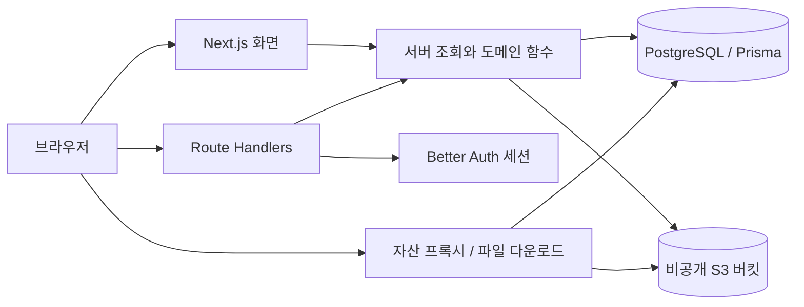

# 구조와 데이터 모델

[README](../README.md) · [제품 방향](product-direction.md) · [Proposal 협업](proposals.md) · [개발과 운영](operations.md)

이 문서는 저장소 코드의 동작을 설명합니다. 배포 환경의 현재 상태를 확인한 문서는 아닙니다.

## 전체 구조

ODR은 Next.js App Router 애플리케이션입니다. 화면과 HTTP API가 같은 저장소에 있으며, Prisma를 통해 PostgreSQL에 메타데이터를 저장하고 S3 호환 저장소에 원본·미리보기·번들을 저장합니다.

잠금 파일의 주요 버전은 Next.js `16.3.3`, Better Auth `1.7.2`, Prisma·Prisma Client `6.19.3`입니다. 실제 설치 버전은 `package-lock.json`을 기준으로 확인합니다.

## 코드를 찾는 순서

| 위치 | 책임 |
| --- | --- |
| `app/projects/[slug]/page.tsx` | Overview와 프로젝트별 Revision·Release·Issue·Proposal·Fork 표시 |
| `app/projects/[slug]/revision-publish-form.tsx` | 원본·미리보기·유닛 정보 발행 입력 |
| `app/projects/[slug]/releases/` | Release 발행 입력과 변경 불가 상세 조회 |
| `src/lib/release-handlers.ts` | Release 소유권·Revision 검증, 번호 산정·원자 발행 |
| `app/proposals/[id]/page.tsx`, `proposal-review.tsx` | 비교 데이터 구성, 리뷰·선택 적용 UI |
| `app/api/` | HTTP 입력, 세션·권한 확인, 응답 |
| `src/lib/proposal-handlers.ts` | Proposal 생성·종료·댓글·리뷰·적용과 트랜잭션 |
| `src/lib/proposal-conflicts.ts` | 유닛 충돌 판정과 변경 ID 계산 |
| `src/lib/proposal-status.ts` | Change 상태로 Proposal 상태 계산 |
| `src/lib/revision-bundle.ts`, `adapters.ts` | 번들 형식, stable ID·kind, capability·SVG 제안 |
| `src/lib/project-validation.ts` | 요청 스키마, 파일 수·크기·문자열 제한 |
| `src/lib/auth.ts`, `session.ts`, `moderation.ts` | 인증, 서버 세션, 관리자 판정 |
| `src/lib/storage.ts` | S3 읽기·쓰기와 자산 프록시 URL |
| `prisma/schema.prisma`, `prisma/migrations/` | 데이터 모델과 실제 SQL 제약·트리거 |
| `e2e/`, `*.test.ts`, `*.test.tsx` | 브라우저·단위·DB 통합 검증 |

## 핵심 엔티티

| 개념 | 저장 형태와 의미 |
| --- | --- |
| Project | 소유자·공개 여부·라이선스·설명·Fork 출처를 가진 협업 공간 |
| Revision | `(projectId, number)`로 구별하는 발행 기록. 이전 Revision, 원본, 라이선스, capability를 보존 |
| Release / ReleaseRevision | 프로젝트 번호를 가진 판본과 기존 Revision 참조. join row가 상세 표시 순서를 보존 |
| Preview | Revision에 속한 순서 있는 PNG/JPG/HTML 미리보기와 대체 텍스트 |
| Proposal | 대상 프로젝트의 `baseRevisionId`, 제안자의 `sourceRevisionId`, 제목·설명·상태 |
| ChangeSet / Change | Proposal의 변경 묶음과 실제 리뷰·적용 단위. `appliedRevisionId`로 채택 결과 추적 |
| ChangeReview | 사용자 리뷰와 시스템 승인 해제·재검토 이력 |
| Issue / IssueComment | 프로젝트 또는 Revision에 대한 논의 |
| Report / Notification | 신고 검토, Issue 생성·Fork 생성 알림 |

**별도 `ChangeUnit` 테이블이나 Dependency 테이블은 없습니다.** 현재 유닛과 유닛 간 의존성은 S3에 저장된 Revision 번들의 `files[]` 항목에 기록합니다. Change의 `targetFileId`가 유닛의 stable ID를 가리킵니다.

Proposal 출처는 `Revision.sourceProposalId`, 적용된 Change, Proposal의 작성자·리뷰어·채택자를 통해 연결합니다. Fork 출처는 프로젝트의 `forkedFromProjectId`·`forkedFromRevisionId`·`forkedFromLicense`로 보존합니다.

## 발행과 불변성

1. 입력·소유권을 확인하고 원본·미리보기를 새 저장 객체로 업로드합니다.
2. DB 트랜잭션에서 Project 행을 잠그고 최신 Revision과 `parentId`를 확인합니다.
3. `isPublished=false` Revision과 Preview를 만들고 같은 트랜잭션 안에서 발행 상태로 전환합니다.
4. 실패하면 DB 작업은 롤백되고, 이번에 업로드한 객체는 정리 시도합니다. DB와 S3가 하나의 분산 트랜잭션을 이루는 것은 아닙니다.

발행 후 Revision·Preview의 변경·삭제와 Preview 추가를 SQL 트리거로 제한합니다. 복원·Fork·Proposal 적용은 기존 Revision을 고치는 대신 새 Revision을 만듭니다. 원본은 `sourceKey`와 `sourceUrl` 중 정확히 하나를 가져야 하며 DB의 XOR 제약도 이를 검사합니다.

발행 시 프로젝트 라이선스를 Revision에 고정합니다. 과거 라이선스·checksum이 기록되지 않은 데이터는 추정해서 채우지 않습니다. 외부 URL 방식은 링크를 보존하지만 외부 파일 자체의 불변성까지 보장하지 않습니다.

발행 API는 `POST /api/projects/{slug}/revisions`의 multipart 입력을 사용합니다. 제목·변경 설명·각 미리보기의 대체 텍스트가 필요합니다. 원본 파일의 합계는 100 MiB, 미리보기는 1~10개·각 10 MiB·합계 50 MiB까지입니다. 미리보기 형식은 PNG/JPG/HTML이며, 대표 이미지는 PNG/JPG만 허용합니다. 직접 `sourceKey`를 지정하는 입력은 받지 않습니다.

## Release v0

`Project → Release → ReleaseRevision → Revision`은 불변 Revision 위에 조회 전용 역사 기록을 둡니다. Release는 같은 Project의 published Revision 1–50개를 참조하며 payload를 복사하지 않습니다. `ReleaseRevision.position`이 Revision 번호 순서를 보존합니다. `(projectId, number)`는 유일하고, 다음 번호 조회와 Release·join row 생성은 한 transaction에서 처리합니다. 동시 번호 충돌은 재시도 없이 409로 반환합니다. 프로젝트 소유자만 발행할 수 있으며 공개 여부는 Project를 따릅니다. v0에는 초안, 수정·삭제, 자산, 완료·안정 상태가 없습니다.

## 번들과 capability

번들은 `{ version: 1 | 2 | 3, files: [...] }` 형태입니다. 각 파일은 `id`, `name`, `mimeType`, `size`, `assetKey`, `previewKeys`를 가지며 `kind`와 `checksum`은 이전 데이터 호환을 위해 선택 필드입니다. 새 파일 발행은 유닛별 `sourceDependencies`가 제출되면 v3, 없으면 v2를 만듭니다. v3의 모든 파일은 의존하는 유닛의 stable ID 목록인 `dependencies` 배열을 가지며, 의존성이 없으면 빈 배열입니다. v1/v2에는 이 필드가 없습니다.

- 새 유닛 ID는 서버가 생성합니다. 다음 발행에서 기존 파일을 `sourceFileIds`로 연결하면 stable ID를 유지합니다. 파일명만 같다고 같은 유닛으로 판단하지 않습니다.
- 새 유닛의 kind는 `artboard`, `component`, `asset`, `token` 중 선택합니다. 기존 유닛을 연결하면 기존 kind를 유지합니다.
- 각 파일 checksum은 서버가 원본 바이트로 계산한 SHA-256입니다. `Revision.sourceChecksum`은 번들 발행에서 **번들 JSON 전체의 해시**이므로 파일 내용 해시와 구분합니다.
- v3 발행은 각 의존 ID가 같은 번들에 존재하는지, 자기 자신을 가리키거나 중복되지 않는지 검사합니다. `dependencyClosure()` 헬퍼는 선택한 유닛에서 연결된 의존 유닛 전체를 구합니다. 유닛 변경 Proposal 생성·선택 적용은 결과 번들에 필요한 유닛이 모두 남는지 검사합니다.
- `STRUCTURED`는 유효한 번들의 파일·유닛을 다룰 수 있음을 뜻합니다. 외부 링크·번들 없는 데이터는 전체 문서 방식이며, 과거 capability `null`은 기록 없음입니다.
- SVG 어댑터는 최대 앞 8 KiB로 SVG 형태를 확인하고 `artboard`를 제안합니다. 현재 신뢰도는 `low`, 성숙도는 `beta`입니다. 사용자 확인을 돕는 제안이며 충돌 검사·승인 결과가 아닙니다.

## 접근과 저장소 경계

인증은 Better Auth 세션을 사용합니다. 이메일·비밀번호 로그인이 활성화되어 있고 이메일 검증은 현재 필수가 아닙니다. GitHub OAuth는 ID와 secret이 모두 설정된 경우에만 활성화됩니다. 관리자 화면은 `admin` 역할 또는 `ADMIN_EMAILS`를 확인합니다.

공개 프로젝트는 익명으로 읽을 수 있습니다. 비공개 프로젝트는 소유자에게만 보이며, 비가시 조회는 존재를 노출하지 않도록 `404`로 처리합니다. Proposal은 대상 프로젝트뿐 아니라 source 프로젝트도 읽을 수 있어야 합니다. 비공개 기여 공간에서 만든 Proposal은 다른 프로젝트 소유자가 리뷰할 수 없습니다.

버킷은 비공개로 두고 자산은 `/api/assets` 또는 Revision의 파일 다운로드 API를 통해 제공합니다. 공개 Fork가 같은 저장 객체를 참조하면 원본 프로젝트가 비공개가 되어도 공개 Fork를 통한 접근은 유지됩니다. 객체 key를 안다는 것 자체가 접근 권한은 아닙니다.

HTML 미리보기에는 스크립트 실행을 제한하는 CSP가 적용됩니다. 구조화 파일은 파일 다운로드 API를 사용하며, 외부 원본 링크는 ODR 저장 객체와 다르게 취급합니다.

## 구현과 로드맵을 구별하기

현재는 파일·유닛 식별, v3 유닛 의존성·closure, 변경별 리뷰, 의존성을 확인하는 선택 적용, upstream 충돌 판정까지 구현되어 있습니다. Penpot 어댑터, 파일 내부 레이어 분해, 제작 도구 자동 동기화는 후속 범위입니다. `DRAFT` 상태는 스키마에 있지만 현재 생성 API는 `OPEN`으로 생성하며 초안 저장·재오픈·Proposal 내용 수정 API는 제공하지 않습니다.

관련 코드: [번들 형식·의존성 검사](../src/lib/revision-bundle.ts), [발행 API](../app/api/projects/[slug]/revisions/route.ts), [Proposal 적용](../src/lib/proposal-handlers.ts).
