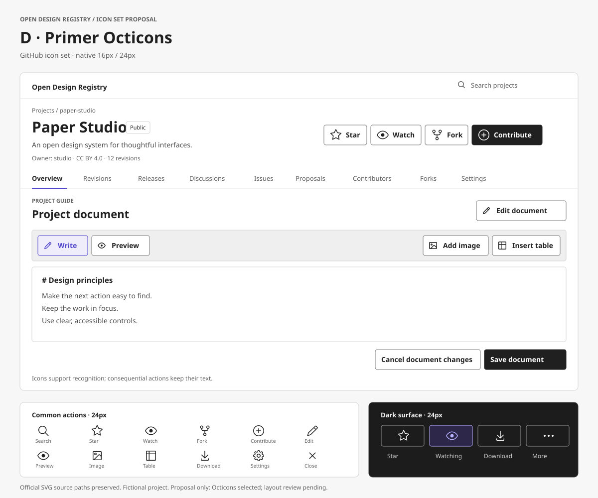
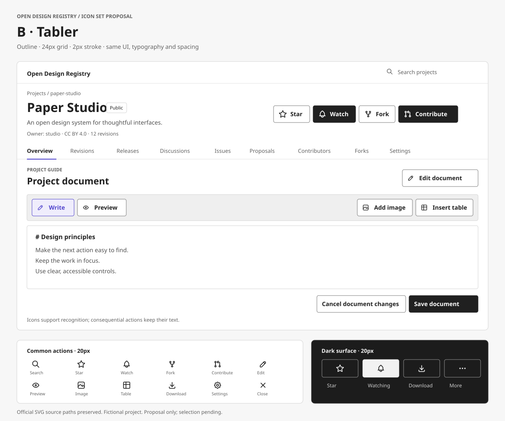
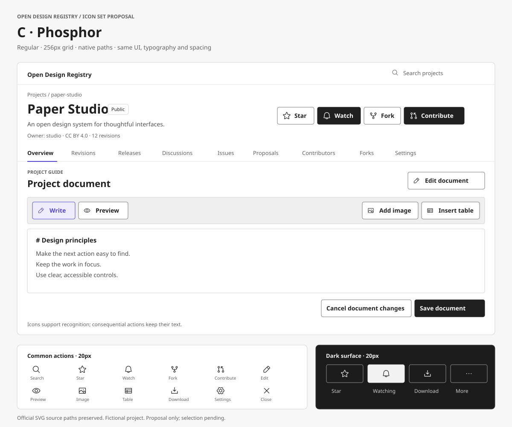

# Icon set options for ODR

Design proposal for the text-heavy project actions and document editor. Related to [#79](https://github.com/makesomethingshit/open-design-registry/issues/79), action hierarchy; this proposal does not complete that issue.

Open [the self-contained comparison](icon-set-options.html) in a browser. Octicons is selected by default. Select All four or an individual family, then compare at desktop and 390px mobile widths. The controls demonstrate appearance only; they do not save, upload, or navigate. No package installation, remote fonts, scripts, or network requests are required by the preview.

## Selected direction and original alternatives

All four retain ODR's Paper / Ink / Iris palette, typography sizes, control radii, 8px icon-label gap and actual project vocabulary. The sample project is fictional. The SVGs and HTML are composed mockups based on current code, not screenshots of the live product or Penpot exports.

| Option | Official set | Rendering | Review focus |
| --- | --- | --- | --- |
| A | [Lucide](https://lucide.dev) | Native outline, 24px grid, 2px stroke | Original alternative; restrained shapes |
| B | [Tabler](https://tabler.io/icons) | Native outline, 24px grid, 2px stroke | Distinct geometry and detail at 16px |
| C | [Phosphor](https://phosphoricons.com) | Native regular paths, 256px grid | Fuller silhouette and weight consistency |
| D | [Primer Octicons](https://primer.style/octicons/) | Native filled SVG paths, separate 16px / 24px variants | Selected by the requester: same icon family as GitHub |

### D — Primer Octicons (selected)

### A — Lucide

### B — Tabler

### C — Phosphor Regular

## Proposed application rules

- Keep icon + text for Star, Watch, Fork, Contribute, Edit document, Add image, Insert table and Download. Contribute uses the existing Proposal concept; confirm its symbol is understandable to designers before implementation.
- Allow icon-only controls for close, zoom and more actions. Provide an accessible name and a tooltip shown on hover and keyboard focus; the preview has names and native title hints, not a production tooltip implementation.
- Keep Save document, Cancel document changes, Submit Proposal and Apply changes as explicit text. Icons must not replace the explanation of consequences.
- For Octicons, use the official 16px variants in compact tools and 24px variants in standard controls; do not scale either variant. Original A/B/C alternatives use 16px / 20px. Keep 32px / 40px desktop controls, 44px minimum mobile targets. Preserve source geometry rather than redrawing icons or forcing Phosphor paths into a stroke model.
- Use one selected family consistently, including existing status icons where equivalents exist. Do not mix families in the production interface. Existing loading feedback remains the spinner, not another icon family.
- Keep current hover, focus, disabled and loading behavior and accessible state announcements. A selected Star/Watch state must remain identifiable by text plus `aria-pressed`; fill can be a supplemental cue after a family is chosen.

## Recommendation and decision

**Selected: D / Primer Octicons**, following the request to use the same icon family as GitHub. A/B/C remain the original comparison alternatives. No production icon dependency has been added.

Octicons supplies separate 16px and 24px drawings; the preview uses each at its native size, following [Primer usage guidelines](https://primer.style/octicons/usage-guidelines/). Watch uses `eye`, Fork uses `repo-forked`, and Contribute uses `plus-circle` for creating an ODR Proposal. This avoids assigning Primer's specifically reserved pull-request symbol to a different concept.

Human review remaining: icon + text versus icon-only placement, native sizes, and the Contribute symbol. Implement through the existing `Icon`, `Button` and `IconButton` boundaries after layout review. Named imports from `@primer/octicons-react` or a small licensed SVG subset are implementation options; packaging is not decided by this static proposal.

## Implementation anchors

- `src/components/ui/icon.tsx` and `button.tsx`: existing icon wrapper and accessible icon-button boundary.
- `src/components/ui/button.module.css` and `src/styles/tokens.css`: existing variants, states, control dimensions and light/dark tokens.
- `app/projects/[slug]/project-shell.tsx`, `project-star-button.tsx`, `project-watch-button.tsx`, `contribute-dialog.tsx`: actual project actions.
- `app/projects/[slug]/project-document.tsx` and `src/components/ui/project-document-editor.tsx`: text-heavy document controls.

## Source mapping and licenses

The preview embeds official SVGs from these pinned commits. Lucide includes ISC and Feather-derived MIT notices; Tabler, Phosphor and Octicons include their MIT notices. Full upstream notices are retained in [icon-set-licenses.txt](icon-set-licenses.txt), and each standalone SVG carries its family notice in metadata. The SVG source paths are preserved; only container size and inherited color change.

- **Lucide**: [1fae58d0a9c6](https://github.com/lucide-icons/lucide/tree/1fae58d0a9c661a338036838caf3399b5507bab6/icons/)
- **Tabler**: [a4ce1404bc6d](https://github.com/tabler/tabler-icons/tree/a4ce1404bc6d24d3c365afe7b258d6bf6f48d62d/icons/outline/)
- **Phosphor**: [2b75f3ad12b4](https://github.com/phosphor-icons/core/tree/2b75f3ad12b420c9504ef05df8d2564a28f8500e/assets/regular/)

- **Octicons**: [1dafaa68a1ce](https://github.com/primer/octicons/tree/1dafaa68a1cef892168aa0fe3d16f0b406715c15/icons/)

| Action | Lucide | Tabler | Phosphor Regular | Octicons |
| --- | --- | --- | --- | --- |
| Search | search | search | magnifying-glass | search |
| Star | star | star | star | star |
| Watch | bell | bell | bell | eye |
| Fork | git-fork | git-fork | git-fork | repo-forked |
| Contribute | git-pull-request | git-pull-request | git-pull-request | plus-circle |
| Edit | pencil | pencil | pencil-simple | pencil |
| Preview | eye | eye | eye | eye |
| Image | image | photo | image | image |
| Table | table | table | table | table |
| Download | download | download | download-simple | download |
| Settings | settings | settings | gear-six | gear |
| Close | x | x | x | x |
| More | ellipsis | dots | dots-three | kebab-horizontal |
| Check | check | check | check | check |
| Plus | plus | plus | plus | plus |
| Minus | minus | minus | minus | dash |
| Zoom | zoom-in | zoom-in | magnifying-glass-plus | zoom-in |
| Warning | triangle-alert | alert-triangle | warning | alert |

## Review checklist

- [x] Select Octicons as the icon family.
- [ ] Review the selected native 16px / 24px variants.
- [ ] Confirm all four show the same labels and placement, including dark samples.
- [ ] Review keyboard focus and accessible names for icon-only controls.
- [ ] Confirm compact/mobile wrapping and 44px touch targets at 390px.
- [ ] Confirm no action meaning is lost by adding or removing a label.

## Validation evidence

The browser preview was inspected at 1440px desktop and 390px mobile widths. At 390px there was no page overflow, no unnamed buttons and no button target below 44px. Each individual family view was opened and captured, including its dark samples and state strip. The three-family desktop comparison was inspected at 1440px. Static SVGs were parsed as XML and their source icons retain the upstream geometry. The selected Octicons view was also inspected at 1440px / 390px: no overflow, no unnamed buttons, all mobile buttons at least 44px, and all 33 glyphs at their native 16px or 24px size. All four views retain the same 23 button labels.

Penpot connection remains unavailable for design execution: the registered tool reports no connected instance. A fresh official remote connection with the renewed configuration initializes, but the read-only design task times out after 120 seconds even with the tab active and MCP marked connected. No design write was attempted. These alternatives are browser/SVG mockups, not verified live Penpot boards.
