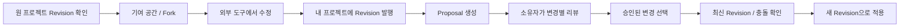

# Proposal 협업 가이드

[문서 목차](README.md) · [Proposal API](proposal-api.md) · [구조와 데이터 모델](architecture.md) · [개발과 운영](operations.md)

이 문서는 저장소 코드의 Proposal 흐름을 설명합니다. 실제 서비스 배포 여부는 별도로 확인해야 합니다.

## 사용 흐름

1. `/login`에서 로그인하고 원 프로젝트의 Revision을 확인합니다. 발행된 Revision이 없으면 기여를 시작할 수 없습니다.
2. **Contribute → Propose a change**로 되돌려 보낼 기여를 시작하거나 **Fork project**로 독립 프로젝트를 만듭니다. 실제 디자인 편집은 외부 제작 도구에서 합니다.
3. 자신의 프로젝트에 수정된 원본과 미리보기를 발행합니다. Proposal의 source는 작성자가 소유한 프로젝트의 발행된 Revision이어야 합니다.
4. 원 프로젝트에서 **Propose changes**를 열고 base·source Revision, 제목·설명, 선택적으로 관련 Issue를 지정합니다. 파일 교체 또는 유닛 변경을 고르지 않으면 전체 문서 교체가 됩니다.
5. 원 프로젝트 소유자가 시각 비교와 변경 내용을 확인해 각 Change를 승인하거나 수정을 요청합니다. 수정 요청에는 댓글이 필요합니다.
6. 소유자가 승인된 변경을 선택하고 적용합니다. 원본 이력을 수정하지 않고 다음 번호의 Revision을 발행합니다.

현재 Fork API는 **공개 프로젝트의 발행 Revision으로 공개 Fork**를 생성하고, 표시된 라이선스로 공개할 권리가 있는지 확인받습니다. 기여 준비와 독립 Fork 모두 `Create fork`로 같은 결과를 명시하며, 비공개 작업 사본을 보장하지 않습니다. 기여 준비 화면은 Fork 직후 대상 프로젝트·base Revision·관련 Issue를 유지한 채 복제된 Revision 1로 돌아옵니다. Fork만으로는 변경이 생기지 않으므로 외부 제작 도구에서 원본을 수정한 뒤 새 Revision을 발행합니다. 발행이 끝나면 대상의 기여 준비 화면으로 돌아와 새 source Revision을 선택합니다. 유닛을 제공하지 않는 형식은 전체 문서 Proposal로 이어질 수 있으며, 실제 변경이 없으면 서버가 생성을 거부합니다.

리뷰어가 source 프로젝트를 읽을 수 있어야 합니다. 현재 비공개 프로젝트의 접근자는 소유자뿐이므로, 다른 소유자에게 제안하려면 source의 공개 여부를 먼저 확인해야 합니다. Proposal을 만든다고 접근 권한이 자동으로 생기지는 않습니다.

### 첫 기여 화면의 안내와 다음 행동

공개 `/contribute`에서 Design request를 고르면 요청 상세에서 Fork·Revision·Proposal의 결과와 검토 담당자를 확인할 수 있습니다. 첫 기여는 Fork → 외부 제작 도구에서 수정 → 새 Revision 발행 → Proposal 제출 순서이며, 이미 수정된 Revision을 소유하고 있다면 Fork 없이 바로 source로 선택할 수 있습니다. 관련 Design request나 Issue도 선택 사항입니다.

기여 준비 화면은 source가 없을 때 Fork를, 복제된 Revision 1일 때 외부 수정·발행을, 수정본이 있을 때 변경 선택·제출을 안내합니다. 발행 화면은 원 프로젝트로 돌아갈 경로와 발행 후 새 source 선택을 설명하고, Proposal 폼은 제출 후 owner review로 이어지며 승인과 적용이 별개임을 명시합니다.

리뷰 화면은 **선택한 변경의 실제 상태**에 따라 다음 행동을 표시합니다. `Changes requested`에서는 원 제출물을 보존한 채 수정·발행·새 Proposal을 만들도록 안내하며, 제출자에게만 자신의 작업 프로젝트로 돌아가는 `Prepare revised work` 링크를 제공합니다. `Approved`는 원본이 아직 바뀌지 않았음을, `Applied`는 원 프로젝트의 새 Revision과 결과 링크를 보여 줍니다. 일부 변경만 적용된 경우에도 나머지가 모두 적용됐다고 표시하지 않습니다.

디자인 기준은 Penpot `Open Design Registry` 파일의 `PUCK-231 · First contribution` 페이지(1440/390 화면과 States and handoff)입니다. 기존 디자인 시스템의 Panel·Banner·Field를 사용하며 별도 튜토리얼이나 데이터 모델 개명은 추가하지 않습니다.

`e2e/mvp.integration.spec.ts`의 first-contributor 시나리오는 실제 DB·스토리지에서 공개 요청 발견, 가입 복귀, Fork, 발행, 제출, 수정 요청, 새 Revision·새 Proposal, 승인, 적용 결과와 원 Revision 보존을 확인합니다. 이는 화면의 행동·결과 안내와 기능 경로를 검증하는 회귀 테스트이며, 실제 신규 디자이너 대상의 이해도 조사 결과를 의미하지는 않습니다.

## 변경 단위

| Change action | 의미 | 조건 |
| --- | --- | --- |
| `REPLACE_DOCUMENT` | source Revision의 전체 원본·미리보기 채택 | 번들 없이도 사용 가능. 유닛별 충돌 판정 대상은 아님 |
| `REPLACE_ASSET` | 기존 파일을 source의 파일로 교체 | 기존 `files[]` 요청 형식. base·source 번들 필요 |
| `MODIFY_UNIT` | 기존 유닛의 파일 내용 교체 | base·source 번들, 대상·소스 ID 필요 |
| `RENAME_UNIT` | 기존 유닛 이름 변경 | base 번들, 다른 유효 이름 필요 |
| `REMOVE_UNIT` | 기존 유닛 제거 | base 번들 필요. 적용 결과에 최소 1개 유닛은 남아야 함 |
| `ADD_UNIT` | source 유닛 추가 | base·source 번들, source kind 필요. 새 target ID는 서버 생성 |

현재 `artboard`·`component`·`asset`·`token`은 파일에 붙이는 유닛 분류입니다. 단일 디자인 파일 내부의 객체를 자동 분해하지 않습니다. 전체 문서 교체와 선택 적용은 서로 다른 적용 방식입니다.

v3 번들의 유닛은 다른 유닛의 stable ID를 `dependencies`로 기록합니다. 유닛 변경 Proposal을 만들 때 필요한 의존 유닛이 제안 결과에 없으면 생성이 거절됩니다(`400`). 선택 적용에서도 의존 ID를 최종 target ID로 연결하고, 적용 결과에 필요한 유닛이 빠지면 `409`와 `missingDependencyIds`를 반환합니다. 함께 선택할 수 있는 미적용 `ADD_UNIT` Change가 있으면 `requiredChangeIds`도 반환합니다. 필요한 변경을 함께 선택하거나 제안을 다시 구성해야 하며, 서버가 의존 변경을 자동으로 선택하지는 않습니다.

## 권한과 상태

| 행동 | 담당자 |
| --- | --- |
| 읽기 | 대상·source 프로젝트와 발행 Revision을 볼 수 있는 사용자 |
| 생성 | 로그인 사용자. source 프로젝트는 본인 소유여야 함 |
| 댓글 | Proposal을 볼 수 있는 로그인 사용자. `CLOSED`에서는 불가 |
| Change 승인·수정 요청·적용 | 대상 프로젝트 소유자 |
| Proposal 닫기 | 작성자 또는 대상 프로젝트 소유자. `ACCEPTED`는 닫기 불가 |

Proposal은 생성 시 `OPEN`입니다. 전부 승인되면 `APPROVED`, 미적용 상태에서 수정 요청이 하나라도 있으면 `CHANGES_REQUESTED`가 됩니다. 일부 적용은 `PARTIALLY_ACCEPTED`, 전부 적용은 `ACCEPTED`입니다. Change 자체는 `PENDING`·`APPROVED`·`CHANGES_REQUESTED`와 별도의 적용 Revision을 가집니다.

`APPROVED`는 자동 적용이 아닙니다. `PARTIALLY_ACCEPTED`는 잔여 작업이 있음을 뜻하며, 현재 API에는 `CLOSED` 재오픈이나 Proposal의 source·변경 내용 수정 기능이 없습니다. 새 source를 제출해야 한다면 새 Proposal을 만듭니다.

## 최신 Revision과 충돌

base 이후 대상 프로젝트에 새 Revision이 생기면 Proposal은 stale 상태입니다. stale 자체가 모든 변경의 충돌을 의미하지는 않습니다. UI는 base·source·latest를 비교하고, 승인 시점과 적용 직전에 서버도 다시 판정합니다.

| base ↔ latest 조건 | 판정 |
| --- | --- |
| 필요한 번들·대상 비교 자료 없음 | `CHECK_UNAVAILABLE` |
| ADD 대상 ID가 base·latest 어디에도 없음 | `NO_CONFLICT` |
| ADD 대상 ID가 latest에 이미 존재 | `CONFLICT` |
| 기존 유닛이 latest에서 제거됨 | `CONFLICT` |
| 기존 유닛의 `dependencies` 집합이 달라짐 | `CONFLICT` — checksum이 같아도 의존성 변경을 먼저 검사 |
| `RENAME_UNIT` 대상의 이름이 latest에서 달라짐 | `CONFLICT` — checksum이 같아도 upstream 이름 변경은 충돌 |
| 의존성 집합 동일·양쪽 checksum 존재·동일, 단 `RENAME_UNIT` 이름 변경 없음 | `NO_CONFLICT` — `MODIFY_UNIT`은 이름/kind/크기/MIME보다 checksum을 우선 |
| 의존성 집합 동일·양쪽 checksum 존재·다름 | `CONFLICT` |
| 의존성 집합 동일·한쪽만 checksum 존재 | `CONFLICT` |
| 의존성 집합 동일·양쪽 checksum 없음·이름/kind/크기/MIME 다름 | `CONFLICT` |
| 의존성 집합 동일·양쪽 checksum 없음·위 메타데이터 같음 | `CHECK_UNAVAILABLE` — 동일 내용으로 추정하지 않음 |

`CHECK_UNAVAILABLE`도 자동 승인·선택 적용을 허용하는 판정이 아닙니다. 현재 base와 latest가 같은 경우에는 upstream 변경이 없으므로 이 비교가 필요하지 않습니다.

`REPLACE_DOCUMENT`는 위 유닛별 표에서 제외됩니다. 대신 stale 상태에서는 최신 Revision과 **선택한 변경 집합 전체**를 다시 확인해야 합니다. 전체 문서 덮어쓰기의 타당성은 사용자가 비교하여 판단합니다.

## 적용 이후의 승인 해제

같은 Proposal에서 일부 변경을 적용해도 남은 미적용 Change의 승인 상태와 리뷰 정보는 유지됩니다. 다만 다음 적용 시 최신 Revision을 기준으로 충돌과 의존성을 다시 검사합니다.

Proposal 적용으로 upstream 유닛의 이름, 내용 또는 의존성 집합이 바뀌면, **다른** Proposal의 승인된 미적용 Change를 영향 범위에 따라 `PENDING`으로 돌려 `INVALIDATED_UPSTREAM` 이력을 남깁니다. 이름만 바뀐 경우 같은 유닛을 대상으로 한 `RENAME_UNIT` 승인만 무효화합니다. 같은 유닛의 `MODIFY_UNIT` 승인과 다른 유닛의 승인은 리뷰 상태·메타데이터를 유지합니다. 이름 변경과 함께 checksum 또는 의존성도 바뀌면 내용·의존성 변경 규칙에 따라 해당 유닛의 승인도 무효화됩니다. 이 서버 조회 조건은 스키마의 `DRAFT`도 포함하지만 현재 생성 API는 `DRAFT`를 만들지 않습니다. 목록의 열린 상태 필터와 같은 조건으로 가정하지 않습니다.

전체 문서 적용도 전후 유효 번들이 있으면 이 무효화 경로를 사용합니다. stable ID의 추가·제거, 의존성 집합 변경 또는 양쪽 checksum이 확인된 내용 변경을 계산합니다. 이름만 바뀐 유닛은 같은 유닛의 `RENAME_UNIT` 승인에만 영향을 줍니다. 이름·checksum·의존성이 모두 그대로인 유닛, 이미 적용된 Change, 비교가 확정되지 않은 legacy 데이터는 무조건 해제하지 않습니다.

**자동 승인 해제 이력 생성은 현재 `applyProposal` 경로에 구현되어 있습니다.** 일반 Revision 발행·복원에도 항상 같은 이력이 생성된다고 가정하면 안 됩니다. 최신 Revision이 달라졌을 때의 승인·적용 전 충돌 재판정과 v3 의존성 검사는 별도로 수행됩니다.

## API와 오류 처리

요청 필드, 예제 payload, 상태 코드와 409 복구 계약은 [Proposal API와 오류 처리](proposal-api.md)에 있습니다. Apply·Approve 실패 시 최신 상태와 실제 적용 결과를 확인한 뒤 다시 판단합니다.

## Proposal 알림

새 Proposal은 대상 프로젝트 소유자에게 알립니다. 전체 상태가 `CHANGES_REQUESTED` 또는 `APPROVED`로 바뀌면 작성자에게, 실제 적용이 완료되면 새 Revision과 함께 작성자에게 알립니다. 자기 자신에게 보내는 알림, 생성 request-ID 재요청, 전체 상태가 같게 유지되는 반복 리뷰와 `alreadyApplied` 재요청은 새 알림을 만들지 않습니다. 알림 저장은 해당 도메인 트랜잭션 안에서 이루어지며 실패하면 변경도 롤백됩니다.

알림은 `/proposals/[id]`로 연결합니다. 수신자가 대상 프로젝트, 발행된 base Revision, 발행된 source Revision과 source 프로젝트를 읽을 수 있는 동안만 보입니다. 기존 읽지 않음 수와 읽음 처리 동작을 사용합니다. Project Watch는 Revision·Release 발행만 알리며 Proposal 알림은 직접 당사자에게 전달됩니다.
