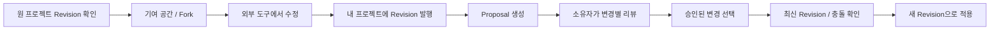

# Proposal 협업 가이드

[README](../README.md) · [구조와 데이터 모델](architecture.md) · [개발과 운영](operations.md)

이 문서는 저장소 코드의 Proposal 흐름을 설명합니다. 실제 서비스 배포 여부는 별도로 확인해야 합니다.

## 사용 흐름



1. `/login`에서 로그인하고 원 프로젝트의 Revision을 확인합니다. 발행된 Revision이 없으면 기여를 시작할 수 없습니다.
2. **Contribute → Propose a change**로 되돌려 보낼 기여를 시작하거나 **Fork project**로 독립 프로젝트를 만듭니다. 실제 디자인 편집은 외부 제작 도구에서 합니다.
3. 자신의 프로젝트에 수정된 원본과 미리보기를 발행합니다. Proposal의 source는 작성자가 소유한 프로젝트의 발행된 Revision이어야 합니다.
4. 원 프로젝트에서 **Propose changes**를 열고 base·source Revision, 제목·설명, 선택적으로 관련 Issue를 지정합니다. 파일 교체 또는 유닛 변경을 고르지 않으면 전체 문서 교체가 됩니다.
5. 원 프로젝트 소유자가 시각 비교와 변경 내용을 확인해 각 Change를 승인하거나 수정을 요청합니다. 수정 요청에는 댓글이 필요합니다.
6. 소유자가 승인된 변경을 선택하고 적용합니다. 원본 이력을 수정하지 않고 다음 번호의 Revision을 발행합니다.

현재 Fork API는 **공개 프로젝트의 발행 Revision으로 공개 Fork**를 생성하고, 표시된 라이선스로 공개할 권리가 있는지 확인받습니다. `Create contribution workspace`라는 문구가 비공개 생성 보장을 뜻하지 않습니다. 기여 공간 생성 직후에는 복제된 Revision 1이 선택된 Proposal 작성 화면으로 이동하므로, 실제 수정안을 제출하려면 생성된 프로젝트에 수정본을 발행하고 source Revision을 바꿔 선택합니다.

리뷰어가 source 프로젝트를 읽을 수 있어야 합니다. 현재 비공개 프로젝트의 접근자는 소유자뿐이므로, 다른 소유자에게 제안하려면 source의 공개 여부를 먼저 확인해야 합니다. Proposal을 만든다고 접근 권한이 자동으로 생기지는 않습니다.

## 변경 단위

| Change action | 의미 | 조건 |
| --- | --- | --- |
| `REPLACE_DOCUMENT` | source Revision의 전체 원본·미리보기 채택 | 번들 없이도 사용 가능. 유닛별 충돌 판정 대상은 아님 |
| `REPLACE_ASSET` | 기존 파일을 source의 파일로 교체 | 기존 `files[]` 요청 형식. base·source 번들 필요 |
| `MODIFY_UNIT` | 기존 유닛의 파일 내용 교체 | base·source 번들, 대상·소스 ID 필요 |
| `RENAME_UNIT` | 기존 유닛 이름 변경 | base 번들, 다른 유효 이름 필요 |
| `REMOVE_UNIT` | 기존 유닛 제거 | base 번들 필요. 적용 결과에 최소 1개 유닛은 남아야 함 |
| `ADD_UNIT` | source 유닛 추가 | base·source 번들, source kind 필요. 새 target ID는 서버 생성 |

현재 `artboard`·`component`·`asset`·`token`은 파일에 붙이는 유닛 분류입니다. 단일 디자인 파일 내부의 객체를 자동 분해하지 않습니다. 전체 문서 교체와 선택 적용은 서로 다른 적용 방식입니다.

v3 번들의 유닛은 다른 유닛의 stable ID를 `dependencies`로 기록합니다. 유닛 변경 Proposal을 만들 때 필요한 의존 유닛이 제안 결과에 없으면 생성이 거절됩니다(`400`). 선택 적용에서도 의존 ID를 최종 target ID로 연결하고, 적용 결과에 필요한 유닛이 빠지면 `409`와 `missingDependencyIds`를 반환합니다. 함께 선택할 수 있는 미적용 `ADD_UNIT` Change가 있으면 `requiredChangeIds`도 반환합니다. 필요한 변경을 함께 선택하거나 제안을 다시 구성해야 하며, 서버가 의존 변경을 자동으로 선택하지는 않습니다.

## 권한과 상태

| 행동 | 담당자 |
| --- | --- |
| 읽기 | 대상·source 프로젝트와 발행 Revision을 볼 수 있는 사용자 |
| 생성 | 로그인 사용자. source 프로젝트는 본인 소유여야 함 |
| 댓글 | Proposal을 볼 수 있는 로그인 사용자. `CLOSED`에서는 불가 |
| Change 승인·수정 요청·적용 | 대상 프로젝트 소유자 |
| Proposal 닫기 | 작성자 또는 대상 프로젝트 소유자. `ACCEPTED`는 닫기 불가 |

Proposal은 생성 시 `OPEN`입니다. 전부 승인되면 `APPROVED`, 미적용 상태에서 수정 요청이 하나라도 있으면 `CHANGES_REQUESTED`가 됩니다. 일부 적용은 `PARTIALLY_ACCEPTED`, 전부 적용은 `ACCEPTED`입니다. Change 자체는 `PENDING`·`APPROVED`·`CHANGES_REQUESTED`와 별도의 적용 Revision을 가집니다.

`APPROVED`는 자동 적용이 아닙니다. `PARTIALLY_ACCEPTED`는 잔여 작업이 있음을 뜻하며, 현재 API에는 `CLOSED` 재오픈이나 Proposal의 source·변경 내용 수정 기능이 없습니다. 새 source를 제출해야 한다면 새 Proposal을 만듭니다.

## 최신 Revision과 충돌

base 이후 대상 프로젝트에 새 Revision이 생기면 Proposal은 stale 상태입니다. stale 자체가 모든 변경의 충돌을 의미하지는 않습니다. UI는 base·source·latest를 비교하고, 승인 시점과 적용 직전에 서버도 다시 판정합니다.

| base ↔ latest 조건 | 판정 |
| --- | --- |
| 필요한 번들·대상 비교 자료 없음 | `CHECK_UNAVAILABLE` |
| ADD 대상 ID가 base·latest 어디에도 없음 | `NO_CONFLICT` |
| ADD 대상 ID가 latest에 이미 존재 | `CONFLICT` |
| 기존 유닛이 latest에서 제거됨 | `CONFLICT` |
| 기존 유닛의 `dependencies` 집합이 달라짐 | `CONFLICT` — checksum이 같아도 의존성 변경을 먼저 검사 |
| 의존성 집합 동일·양쪽 checksum 존재·동일 | `NO_CONFLICT` — 내용 비교에서는 이름/kind/크기/MIME보다 checksum을 우선 |
| 의존성 집합 동일·양쪽 checksum 존재·다름 | `CONFLICT` |
| 의존성 집합 동일·한쪽만 checksum 존재 | `CONFLICT` |
| 의존성 집합 동일·양쪽 checksum 없음·이름/kind/크기/MIME 다름 | `CONFLICT` |
| 의존성 집합 동일·양쪽 checksum 없음·위 메타데이터 같음 | `CHECK_UNAVAILABLE` — 동일 내용으로 추정하지 않음 |

`CHECK_UNAVAILABLE`도 자동 승인·선택 적용을 허용하는 판정이 아닙니다. 현재 base와 latest가 같은 경우에는 upstream 변경이 없으므로 이 비교가 필요하지 않습니다.

`REPLACE_DOCUMENT`는 위 유닛별 표에서 제외됩니다. 대신 stale 상태에서는 최신 Revision과 **선택한 변경 집합 전체**를 다시 확인해야 합니다. 전체 문서 덮어쓰기의 타당성은 사용자가 비교하여 판단합니다.

## 적용 이후의 승인 해제

같은 Proposal에서 일부 변경을 적용해도 남은 미적용 Change의 승인 상태와 리뷰 정보는 유지됩니다. 다만 다음 적용 시 최신 Revision을 기준으로 충돌과 의존성을 다시 검사합니다.

Proposal 적용으로 upstream 유닛의 내용이나 의존성 집합이 바뀌면, **다른** 열려 있는 Proposal에서 그 유닛을 대상으로 승인된 미적용 Change를 `PENDING`으로 돌리고 `INVALIDATED_UPSTREAM` 이력을 남깁니다.

전체 문서 적용도 전후 유효 번들이 있으면 이 무효화 경로를 사용합니다. stable ID의 추가·제거, 의존성 집합 변경 또는 양쪽 checksum이 확인된 내용 변경을 계산합니다. checksum이 같고 의존성도 같은 유닛, 이미 적용된 Change, 비교가 확정되지 않은 legacy 데이터는 무조건 해제하지 않습니다.

**자동 승인 해제 이력 생성은 현재 `applyProposal` 경로에 구현되어 있습니다.** 일반 Revision 발행·복원에도 항상 같은 이력이 생성된다고 가정하면 안 됩니다. 최신 Revision이 달라졌을 때의 승인·적용 전 충돌 재판정과 v3 의존성 검사는 별도로 수행됩니다.

## 핵심 API

아래 경로는 세션 쿠키를 사용하는 앱 API입니다. 별도의 공개 API 키 인증 체계가 있는 것으로 가정하지 않습니다. 전체 라우트 위치는 `app/api/`에서 확인할 수 있습니다.

| 메서드·경로 | 용도 |
| --- | --- |
| `GET /api/projects/{slug}/proposals` | 가시 Proposal 목록, `status=open|closed`, cursor·limit 지원 |
| `POST /api/projects/{slug}/proposals` | Proposal 생성 |
| `GET /api/proposals/{id}` | 상세 데이터 |
| `PATCH /api/proposals/{id}` | `{ "status": "CLOSED" }` |
| `POST /api/proposals/{id}/comments` | `{ "body": "..." }` |
| `PATCH /api/proposals/{id}/changes/{changeId}` | `status=APPROVED|CHANGES_REQUESTED`, `comment` |
| `POST /api/proposals/{id}/apply` | 승인된 `changeIds` 선택 적용 |

생성 예시입니다. ID는 실제 조회 결과로 치환하고 `requestId`는 한 생성 작업마다 UUID를 만듭니다.

```json
{
  "baseRevisionId": "base-revision-id",
  "sourceRevisionId": "source-revision-id",
  "title": "홈 화면과 로고 개선",
  "body": "간격을 조정하고 로고 파일을 교체했습니다.",
  "requestId": "7adb16e2-a3da-4569-9e04-48003f98b6dd",
  "changes": [
    { "action": "MODIFY_UNIT", "targetFileId": "home-unit-id", "sourceFileId": "updated-home-id" },
    { "action": "RENAME_UNIT", "targetFileId": "logo-unit-id", "newName": "Primary logo" }
  ]
}
```

`changes` 또는 기존 `files` 배열 중 하나만 보냅니다(1~10개). 둘 다 없으면 `REPLACE_DOCUMENT` 하나를 생성합니다. base는 대상 프로젝트의 발행 Revision, source는 작성자 소유 프로젝트의 발행 Revision이어야 하며 Fork 혈통 자체를 필수 조건으로 검사하지는 않습니다.

생성은 `201`; 같은 `(projectId, authorId, requestId)` 재시도는 기존 Proposal과 `200`을 반환합니다. 내용이 다른 새 제안에 이전 requestId를 재사용하지 않습니다.

적용 예시에서 stale이 아니라면 `changeIds`만 필요합니다. stale이면 사용자가 실제 확인한 최신 Revision과 선택 집합을 함께 보냅니다.

```json
{
  "changeIds": ["approved-change-id"],
  "reviewedLatestRevisionId": "latest-revision-id",
  "reviewedChangeIds": ["approved-change-id"]
}
```

이 값은 확인 기록이며 서버 재검사를 우회하지 않습니다. 적용은 새 Revision과 `201`, 선택이 이미 같은 Revision에 적용되어 있으면 기존 결과와 `200`을 반환합니다. 일부만 이미 적용되었거나 적용 Revision이 섞인 요청은 충돌할 수 있습니다.

## 오류 처리

| 응답 | 확인할 내용 |
| --- | --- |
| `400` | 필수 입력·실제 ID·배열 중복·source 소유권·변경 스키마·Proposal 생성 시 누락된 의존 유닛 |
| `401` | 로그인 세션 |
| `403` | 대상 프로젝트 소유자 등 필요한 행동 권한 |
| `404` | 실제 존재와 가시성 모두 확인. 비공개 여부를 추정해 노출하지 않음 |
| `409` | 최신 Revision 변경, 충돌/확인 불가, 승인 상태, 이미 적용, 제거된 대상, 마지막 유닛 제거, 선택 적용 후 누락된 의존 유닛 등 |
| `500` | 서버 로그·DB·스토리지 오류. 결과 저장 여부를 확인한 뒤 재시도 판단 |

Apply·Approve가 `409`이면 UI는 최신 상태를 다시 조회하고 비교 확인·모달을 초기화합니다. 응답에 유효한 `conflictChangeIds`가 있으면 그 선택을 해제합니다. payload가 없거나 잘못되었다고 무조건 전체 선택을 없애거나 자동 재적용하지 않습니다. API 소비자도 최신 데이터와 승인·선택 가능 여부를 다시 확인해야 합니다.

관련 코드: [Proposal 처리](../src/lib/proposal-handlers.ts), [충돌 판정](../src/lib/proposal-conflicts.ts), [번들·의존성](../src/lib/revision-bundle.ts), [입력 스키마](../src/lib/project-validation.ts).
